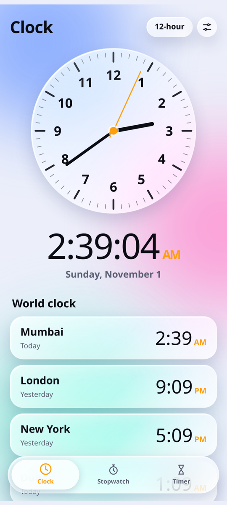
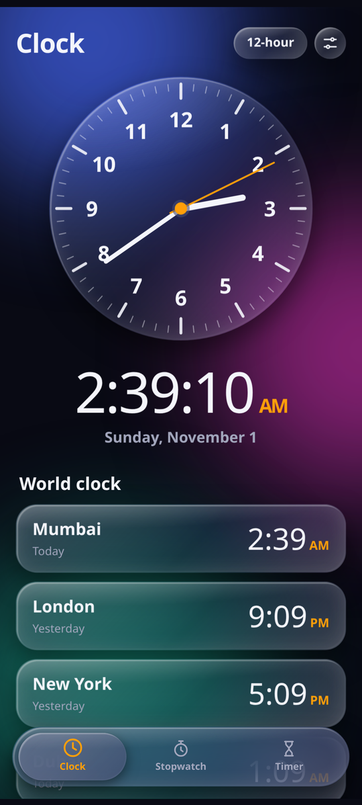
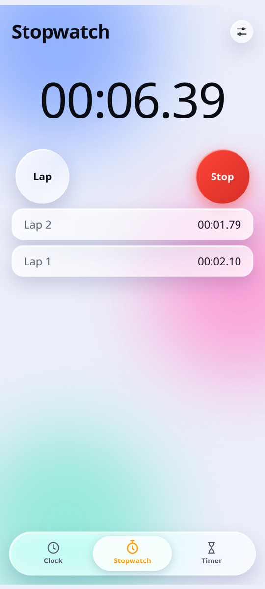
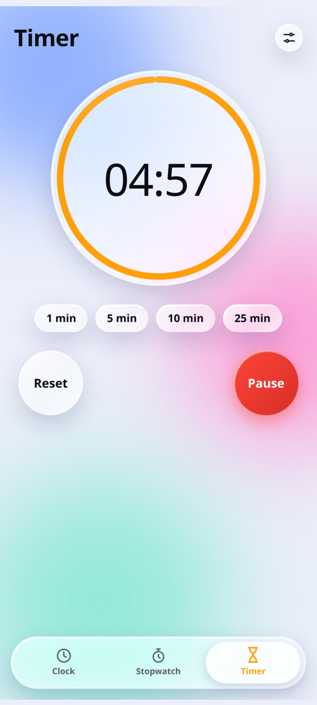
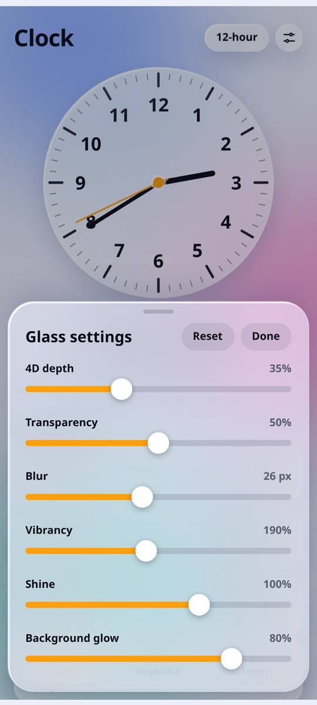

<div align="center">

<a href="https://github.com/technicalnihilist-lgtm/liquid-clock/stargazers"></a>&nbsp;<a href="https://github.com/technicalnihilist-lgtm/liquid-clock/network/members"></a>

<h3>Glassy liquid-blob clock for Android — analog clock, world clock, stopwatch and timer in one…</h3>

   

<a href="https://github.com/technicalnihilist-lgtm/liquid-clock/releases/latest"></a>

<b>Support the work</b>

  

<sub>Donations aren't live yet — Paytm, UPI, PayPal and Buy&nbsp;Me&nbsp;a&nbsp;Coffee all show <b>coming soon</b>. Until then, a ⭐ star is the best support.</sub>

<a href="https://github.com/technicalnihilist-lgtm/liquid-clock/releases/latest"></a>  <a href="https://github.com/technicalnihilist-lgtm/liquid-clock/releases"></a>

<h4>Get it from</h4>

<a href="https://github.com/technicalnihilist-lgtm/liquid-clock/releases"></a> <a href="https://github.com/technicalnihilist-lgtm/liquid-clock/archive/refs/heads/main.zip"></a>

</div>

---

---

## Screenshots

| Clock | Clock (dark) | Stopwatch | Timer | Glass settings |
| --- | --- | --- | --- | --- |
|  |  |  |  |  |

Direct links:

- https://raw.githubusercontent.com/technicalnihilist-lgtm/liquid-clock/main/screenshots/1-clock-light.png
- https://raw.githubusercontent.com/technicalnihilist-lgtm/liquid-clock/main/screenshots/2-clock-dark.png
- https://raw.githubusercontent.com/technicalnihilist-lgtm/liquid-clock/main/screenshots/3-stopwatch.png
- https://raw.githubusercontent.com/technicalnihilist-lgtm/liquid-clock/main/screenshots/4-timer.png
- https://raw.githubusercontent.com/technicalnihilist-lgtm/liquid-clock/main/screenshots/5-glass-settings.png

App icon: https://raw.githubusercontent.com/technicalnihilist-lgtm/liquid-clock/main/icon.png

## Features

- **Clock** — smooth sweeping analog face (60fps, sub-second hands), big digital readout, 12/24-hour toggle that is remembered, date line
- **World clock** — Mumbai, London, New York, Dubai, Tokyo, Sydney with Today / Tomorrow / Yesterday labels relative to your own date
- **Stopwatch** — start / stop / lap / reset, split times per lap
- **Timer** — 1, 5, 10 and 25 minute presets, circular progress ring, pause / resume / reset, beep + vibration when it finishes, and the alarm fires even if you are on another tab
- **4D depth** — the layers lean toward your finger as you drag and toward the phone itself when it reports a tilt; near layers travel further than far ones and the specular highlight slides with them. Intensity is a slider, so it can be turned off entirely
- **Glass settings** — a bottom sheet with live sliders for depth, transparency, blur, vibrancy, shine and background glow; your mix is saved
- **Motion** — spring-eased tab transitions, a sliding glass lens you can drag between the three tabs, staggered content reveals and iOS-style rubber-band overscroll
- **Dark mode** — follows the system setting live, no restart needed
- **Edge to edge** — draws under the status and navigation bars, correct insets on notched phones
- **Offline** — no internet permission at all, everything runs from local assets
- **State survives** — stopwatch and timer keep running across app switches and relaunches (wall-clock based, not frame based)
- **Back button** — closes the settings sheet first, then returns to the Clock tab, then exits

## Install

**[Download LiquidClock-1.2.0.apk](https://github.com/technicalnihilist-lgtm/liquid-clock/releases/latest/download/LiquidClock-1.2.0.apk)** and open it on your phone. You will need to allow install from unknown sources, since this is a self-signed build rather than a Play Store release.

- Minimum Android 6.0 (API 23), targets Android 14 (API 34)
- Size ~258 KB, no dependencies, no internet permission

Newer builds are published on the [Releases](https://github.com/technicalnihilist-lgtm/liquid-clock/releases) page; the same copy also sits in `releases/` in the repo.

## Changelog

### 1.2.0
- 4D depth: layered parallax that follows your finger or the phone's tilt, with a specular highlight that moves with it
- New depth slider at the top of the glass settings sheet (0 turns the effect off), saved with the rest of the mix
- Depth is time-based rather than frame-based, so it feels the same at 60fps and on a slow frame
- Depth only follows touch, never mouse hover, so buttons never slide out from under a tap
- Parallax is done with translation and scale only — a 3D rotate on the page makes `backdrop-filter` repaint the glass in visible tiles

### 1.1.0
- Glass settings sheet: transparency, blur, vibrancy, shine and background glow sliders, remembered across launches
- Draggable glass lens in the bottom navigation, spring-eased tab and content transitions
- Rubber-band overscroll on scrollable pages
- Timer completion is now checked on every tab, not just while the Timer tab is open
- Single rAF loop with change-guarded text updates, so the clock stops re-writing the DOM 60 times a second
- Version name and code are now build parameters (`VER`, `VCODE`)

### 1.0.0
- First release: clock, world clock, stopwatch, timer, dark mode, edge-to-edge, persistent state

## Build

No Gradle needed — the APK is assembled with the Android SDK command line tools.

```bash
export ANDROID_HOME=$HOME/Android/Sdk   # needs build-tools;34.0.0 and platforms;android-34
VER=1.2.0 VCODE=3 bash build.sh
```

The output lands in `build/LiquidClock-<version>.apk`. The first run generates a signing key at `keystore/liquidclock.jks`; keep that file, because Android only accepts updates signed with the same key.

Screenshots are generated from the real UI with headless Chromium:

```bash
pip install playwright
python3 tools/make_screenshots.py
python3 tools/make_hero.py
```

## Project layout

```
assets/index.html          the entire UI (HTML + CSS + JS, no build step)
src/.../MainActivity.java  native shell: WebView, insets, theme, vibration, back
res/                       icons, theme, strings
AndroidManifest.xml        permissions: VIBRATE only
build.sh                   aapt2 -> javac -> d8 -> zipalign -> apksigner
tools/make_icons.py        generates launcher icons
tools/make_screenshots.py  renders screenshots from assets/index.html
```

## Design notes

The palette, glass panels, floating blobs and the orange accent are unchanged from the original design. What changed for the app version: the three nav icons are inline SVG instead of emoji (so they render the same on every OEM), safe-area insets come from the native layer, the 12/24-hour choice, running timers and glass settings persist, and the world clock list starts with Mumbai.

## License

MIT

---

---

## 🌍 Languages

<sub>Donations are <b>coming soon</b> in every language below — nothing to pay today, nothing to click.</sub>

<div align="center">

<sub><b>हिन्दी · বাংলা · मराठी · తెలుగు · தமிழ் · ગુજરાતી · ಕನ್ನಡ · മലയാളം · ਪੰਜਾਬੀ · ଓଡ଼ିଆ · অসমীয়া · اردو</b></sub>

</div>

<details>
<summary><b>🌍 Open the same message in 53 languages</b></summary>

**🇮🇳 Indian languages**

- **हिन्दी** (Hindi) — ☕ जल्द ही आ रहा है। · ⭐ अगर आपको यह ऐप और हमारा काम पसंद है, तो कृपया रिपॉजिटरी को स्टार दें और हमें फॉलो करें।
- **বাংলা** (Bengali) — ☕ খুব শিগগিরই আসছে। · ⭐ যদি আপনার এই অ্যাপ এবং আমাদের কাজ ভালো লাগে, তবে অনুগ্রহ করে রিপোজিটরিটিকে একটি স্টার দিন এবং আমাদের ফলো করুন।
- **मराठी** (Marathi) — ☕ लवकरच येत आहे. · ⭐ जर तुम्हाला हे ॲप आणि आमचं काम आवडलं असेल, तर कृपया रिपॉझिटरीला स्टार द्या आणि आम्हाला फॉलो करा.
- **తెలుగు** (Telugu) — ☕ త్వరలో రాబోతోంది. · ⭐ మీకు ఈ యాప్, మా పని నచ్చితే, దయచేసి రిపోజిటరీకి ఒక స్టార్ ఇచ్చి మమ్మల్ని ఫాలో అవ్వండి.
- **தமிழ்** (Tamil) — ☕ விரைவில் வருகிறது. · ⭐ உங்களுக்கு இந்த ஆப்பும் எங்க வேலையும் பிடிச்சிருந்தா, தயவுசெஞ்சு இந்த ரெபாசிட்டரிக்கு ஒரு ஸ்டார்…
- **ગુજરાતી** (Gujarati) — ☕ ટૂંક સમયમાં આવી રહ્યું છે. · ⭐ જો તમને આ એપ અને અમારું કામ ગમતું હોય, તો પ્લીઝ રિપોઝિટરીને સ્ટાર આપો અને અમને ફોલો કરો.
- **ಕನ್ನಡ** (Kannada) — ☕ ಶೀಘ್ರದಲ್ಲೇ ಬರುತ್ತಿದೆ. · ⭐ ನಿಮಗೆ ಈ ಆ್ಯಪ್ ಮತ್ತು ನಮ್ಮ ಕೆಲಸ ಇಷ್ಟವಾದರೆ, ದಯವಿಟ್ಟು ರೆಪೊಸಿಟರಿಗೆ ಸ್ಟಾರ್ ಕೊಡಿ ಮತ್ತು ನಮ್ಮನ್ನು ಫಾಲೋ ಮಾಡಿ.
- **മലയാളം** (Malayalam) — ☕ ഉടൻ വരുന്നു. · ⭐ നിങ്ങൾക്ക് ഈ ആപ്പും ഞങ്ങളുടെ പ്രവർത്തനവും ഇഷ്ടപ്പെട്ടെങ്കിൽ, ദയവായി റെപ്പോസിറ്ററിക്ക് ഒരു സ്റ്റാർ…
- **ਪੰਜਾਬੀ** (Punjabi) — ☕ ਜਲਦੀ ਆ ਰਿਹਾ ਹੈ। · ⭐ ਜੇ ਤੁਹਾਨੂੰ ਇਹ ਐਪ ਅਤੇ ਸਾਡਾ ਕੰਮ ਪਸੰਦ ਹੈ, ਤਾਂ ਕਿਰਪਾ ਕਰਕੇ ਰਿਪੋਜ਼ਟਰੀ ਨੂੰ ਸਟਾਰ ਦਿਓ ਅਤੇ ਸਾਨੂੰ ਫਾਲੋ ਕਰੋ।
- **ଓଡ଼ିଆ** (Odia) — ☕ ଖୁବ୍ ଶୀଘ୍ର ଆସୁଛି। · ⭐ ଯଦି ଆପଣଙ୍କୁ ଏହି ଆପ୍ ଏବଂ ଆମର କାମ ଭଲ ଲାଗୁଛି, ତେବେ ଦୟାକରି ରିପୋଜିଟୋରୀକୁ ଗୋଟିଏ ଷ୍ଟାର୍ ଦିଅନ୍ତୁ ଏବଂ ଆମକୁ ଫଲୋ କରନ୍ତୁ।
- **অসমীয়া** (Assamese) — ☕ অতি সোনকালেই আহি আছে। · ⭐ যদি আপুনি এই এপটো আৰু আমাৰ কাম ভাল পায়, তেন্তে অনুগ্ৰহ কৰি ৰিপজিটৰীটোক এটা ষ্টাৰ দিয়ক আৰু আমাক ফ'ল' কৰক।
- **اردو** (Urdu) — ☕ جلد آرہا ہے۔ · ⭐ اگر آپ کو یہ ایپ اور ہمارا کام پسند آئے تو براہ کرم ریپازٹری کو سٹار دیں اور ہمیں فالو کریں۔
- **संस्कृतम्** (Sanskrit) — ☕ शीघ्रमेव आगच्छति।
- **मैथिली** (Maithili) — ☕ जल्दिये आबि रहल अछि।
- **कोंकणी** (Konkani) — ☕ रोखडेंच येता.
- **کٲشُر** (Kashmiri) — ☕ جَلدی یِوان چھُ۔
- **سنڌي** (Sindhi) — ☕ जल्द अची रह्यो आहे।
- **डोगरी** (Dogri) — ☕ जल्दी आ करदा ऐ।
- **ꯃꯤꯇꯩ ꯂꯣꯟ** (Manipuri) — ☕ ꯑꯊꯨꯕꯥ ꯃꯇꯝꯗꯥ ꯂꯥꯛꯀꯅꯤ꯫
- **बर’** (Bodo) — ☕ थाबैनो फैगोन।
- **ᱥᱟᱱᱛᱟᱲᱤ** (Santali) — ☕ ᱞᱚᱜᱚᱱ ᱦᱤᱡᱩᱜ ᱠᱟᱱᱟ᱾
- **नेपाली** (Nepali) — ☕ छिट्टै आउँदैछ। · ⭐ यदि तपाईंलाई यो एप र हाम्रो काम मन पर्‍यो भने, कृपया रिपोजिटरीलाई स्टार दिनुहोस् र हामीलाई फलो गर्नुहोस्।

**🌍 World languages**

- **العربية** (Arabic) — ☕ قريبًا. · ⭐ إذا أعجبك هذا التطبيق وعملنا، فيرجى منح المستودع نجمة ومتابعتنا.
- **简体中文** (Chinese (Simplified)) — ☕ 即将推出。
- **繁體中文** (Chinese (Traditional)) — ☕ 即將推出。
- **Čeština** (Czech) — ☕ Již brzy.
- **Dansk** (Danish) — ☕ Kommer snart.
- **Nederlands** (Dutch) — ☕ Binnenkort beschikbaar. · ⭐ Vind je deze app en ons werk leuk?
- **Filipino** (Filipino) — ☕ Malapit na.
- **Suomi** (Finnish) — ☕ Tulossa pian.
- **Français** (French) — ☕ Bientôt disponible. · ⭐ Si cette application et notre travail vous plaisent, mettez une étoile au dépôt et suivez-nous.
- **Deutsch** (German) — ☕ Bald verfügbar. · ⭐ Wenn dir diese App und unsere Arbeit gefallen, gib dem Repository einen Stern und folge uns.
- **Ελληνικά** (Greek) — ☕ Έρχεται σύντομα.
- **עברית** (Hebrew) — ☕ בקרוב.
- **Magyar** (Hungarian) — ☕ Hamarosan.
- **Bahasa Indonesia** (Indonesian) — ☕ Segera hadir. · ⭐ Jika kamu suka aplikasi ini dan karya kami, beri bintang pada repositori ini dan ikuti kami.
- **Italiano** (Italian) — ☕ In arrivo.
- **日本語** (Japanese) — ☕ 近日公開。 · ⭐ このアプリと私たちの仕事が気に入ったら、リポジトリにスターを付けてフォローしてください。
- **한국어** (Korean) — ☕ 곧 공개됩니다. · ⭐ 이 앱과 저희 작업이 마음에 드신다면 저장소에 스타를 눌러 주시고 팔로우해 주세요.
- **Bahasa Melayu** (Malay) — ☕ Akan datang.
- **Norsk** (Norwegian) — ☕ Kommer snart.
- **فارسی** (Persian) — ☕ به‌زودی.
- **Polski** (Polish) — ☕ Wkrótce. · ⭐ Jeśli podoba Ci się ta aplikacja i nasza praca, daj repozytorium gwiazdkę i obserwuj nas.
- **Português** (Portuguese) — ☕ Em breve.
- **Română** (Romanian) — ☕ În curând.
- **Русский** (Russian) — ☕ Скоро. · ⭐ Если вам нравится это приложение и наша работа, поставьте звёздочку репозиторию и подпишитесь на нас.
- **Español** (Spanish) — ☕ Muy pronto. · ⭐ Si te gusta esta app y nuestro trabajo, dale una estrella al repositorio y síguenos.
- **Kiswahili** (Swahili) — ☕ Inakuja hivi karibuni.
- **Svenska** (Swedish) — ☕ Kommer snart.
- **ไทย** (Thai) — ☕ เร็ว ๆ นี้
- **Türkçe** (Turkish) — ☕ Çok yakında.
- **Українська** (Ukrainian) — ☕ Незабаром.
- **Tiếng Việt** (Vietnamese) — ☕ Sắp ra mắt. · ⭐ Nếu bạn thích ứng dụng này và công việc của chúng tôi, hãy tặng kho lưu trữ một ngôi sao và theo…

</details>

