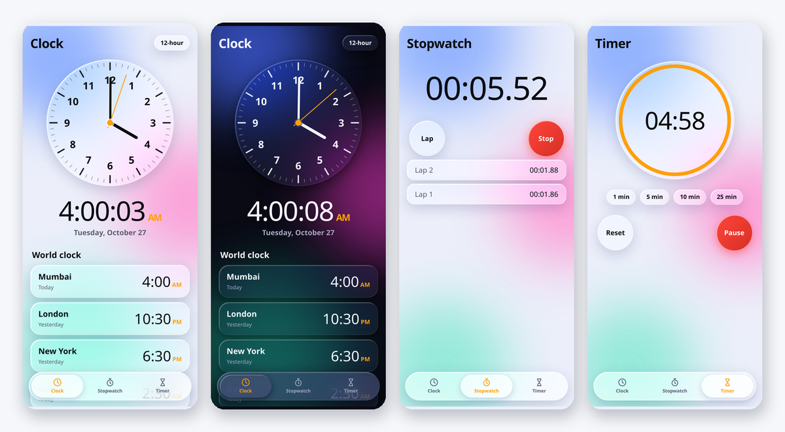

# Liquid Clock

A glassy, liquid-blob clock for Android — analog + digital clock, world clock, stopwatch and timer in one offline app.



Built from a single-page HTML design and wrapped in a native Android WebView shell, so the whole UI is one file you can edit without touching Java.

## Features

- **Clock** — smooth sweeping analog face (60fps, sub-second hands), big digital readout, 12/24-hour toggle that is remembered, date line
- **World clock** — Mumbai, London, New York, Dubai, Tokyo, Sydney with Today / Tomorrow / Yesterday labels relative to your own date
- **Stopwatch** — start / stop / lap / reset, split times per lap
- **Timer** — 1, 5, 10 and 25 minute presets, circular progress ring, pause / resume / reset, beep + vibration when it finishes
- **Dark mode** — follows the system setting live, no restart needed
- **Edge to edge** — draws under the status and navigation bars, correct insets on notched phones
- **Offline** — no internet permission at all, everything runs from local assets
- **State survives** — stopwatch and timer keep running across app switches and relaunches (wall-clock based, not frame based)
- **Back button** — returns to the Clock tab first, then exits

## Install

**[Download LiquidClock-1.0.0.apk](https://github.com/technicalnihilist-lgtm/liquid-clock/releases/latest/download/LiquidClock-1.0.0.apk)** and open it on your phone. You will need to allow install from unknown sources, since this is a self-signed build rather than a Play Store release.

- Minimum Android 6.0 (API 23), targets Android 14 (API 34)
- Size ~254 KB, no dependencies, no internet permission
- APK SHA-256: `2628ef7e3dda7acf9f0cf3269ede70b8cd47ec6ce24c6f6b2c84f931d1324ec2`

Newer builds are published on the [Releases](https://github.com/technicalnihilist-lgtm/liquid-clock/releases) page; the same copy also sits in `releases/` in the repo.

## Build

No Gradle needed — the APK is assembled with the Android SDK command line tools.

```bash
export ANDROID_HOME=$HOME/Android/Sdk   # needs build-tools;34.0.0 and platforms;android-34
bash build.sh
```

The output lands in `build/LiquidClock-1.0.0.apk`. The first run generates a signing key at `keystore/liquidclock.jks`; keep that file, because Android only accepts updates signed with the same key.

Screenshots are generated from the real UI with headless Chromium:

```bash
pip install playwright
python3 tools/make_screenshots.py
python3 tools/make_hero.py
```

## Project layout

```
assets/index.html          the entire UI (HTML + CSS + JS, no build step)
src/.../MainActivity.java  native shell: WebView, insets, theme, vibration, back
res/                       icons, theme, strings
AndroidManifest.xml        permissions: VIBRATE only
build.sh                   aapt2 -> javac -> d8 -> zipalign -> apksigner
tools/make_icons.py        generates launcher icons
tools/make_screenshots.py  renders screenshots from assets/index.html
```

## Design notes

The palette, glass panels, floating blobs and the orange accent are unchanged from the original design. What changed for the app version: the three nav icons are inline SVG instead of emoji (so they render the same on every OEM), safe-area insets come from the native layer, the 12/24-hour choice and running timers persist, and the world clock list starts with Mumbai.

## License

MIT
